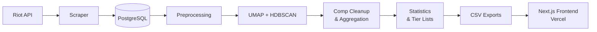

# TFTExodia - Project Showcase

**A data analytics pipeline that discovers the meta in Teamfight Tactics by scraping high-elo match data from the Riot Games API and clustering player boards with UMAP + HDBSCAN.**

Processes **200k+ high-elo matches** and surfaces **35+ distinct compositions** per patch, including several archetypes not tracked on other platforms like MetaTFT.

**Live site:** [TFTExodia.com](https://tftexodia.com)

---

## What it does

TFT Exodia automatically tracks the highest-ranked TFT players in the world (Challenger, Grandmaster, and Master tiers on the Korean ladder - customisable), pulls their match histories from the Riot Games API, and runs an end-to-end ML pipeline that:

- Identifies the dominant team compositions ("comps") of 9-10 units currently being played
- Distinguishes meta from off-meta strategies via density-based clustering
- Calculates carry playrates, best-in-slot item builds, and per-unit tier rankings
- Tracks how the meta shifts day-by-day across patches

The full pipeline runs autonomously on a daily schedule. Results are published to the live site.

## Architecture




`cron` triggers `run_tft.sh`, which executes the scrape → analyse → export workflow inside an isolated virtualenv and pipes all output to a rotating log file for monitoring.

## Tech stack


| Layer          | Tools                                                      |
| -------------- | ---------------------------------------------------------- |
| Ingestion      | Python, `requests`, Riot Games API                         |
| Storage        | PostgreSQL, `psycopg2`                                     |
| ML / analytics | `scikit-learn`, `umap-learn`, `hdbscan`, `pandas`, `numpy` |
| Frontend       | TypeScript, Next.js (React 19), Tailwind CSS, Vercel       |
| Orchestration  | Bash, `cron`, Python virtualenv                            |
| Visualisation  | `matplotlib` (internal), web frontend (live site)          |


## Technical highlights

### Rate-limit-aware scraping

Riot's API has aggressive rate limits, so the scraper is designed to extract maximum signal per call:

- A `top_players` table tracks every monitored account along with a `last_checked` timestamp
- A B-tree index on `last_checked` lets the scraper instantly query the *stalest* player — the one most likely to have unseen matches — without scanning the full table
- A `processed_matches` ledger combined with `ON CONFLICT DO NOTHING` on insert ensures no API call is ever wasted re-fetching a match already in the database
- Cascading foreign-key constraints (`ON DELETE CASCADE`) keep the relational model consistent when old matches are pruned

### Discovering comps with UMAP → HDBSCAN

End-game boards are inherently high-dimensional: each board is a set drawn from ~60 possible champions. Identifying "comps" means finding clusters of similar boards in this sparse space without hand-coding what a comp looks like (which would go stale every patch). The pipeline:

1. **Multi-hot encodes** each board with `MultiLabelBinarizer`, turning a champion list into a binary vector
2. **Reduces dimensions** using **UMAP** with **Jaccard distance** — well-suited for binary set-membership data, and better at preserving local structure than PCA on input this sparse
3. **Clusters** the 2D embedding with **HDBSCAN**, which handles clusters of varying density and naturally treats off-meta or transitional boards as noise rather than forcing them into a group

The result is an unsupervised system that *discovers* the meta from raw player behaviour every day.

### Patch-aware analytics

TFT releases balance changes regularly, and a patch can completely invalidate prior data. Analytics are isolated by patch version so that a freshly-released patch's tier list isn't polluted by data from the previous meta.

### Schema design

Six tables with proper foreign-key relationships:

- `top_players` — tracked accounts and last-scraped timestamps
- `processed_matches` — idempotent ingestion ledger
- `matches`, `participants`, `participant_units`, `participant_traits` — the core relational model

Cascading deletes mean a single `DELETE FROM matches WHERE ...` correctly cleans up every dependent row across all four tables.

## Repo structure

```
tft-exodia/
├── main.py                         # pipeline orchestrator
├── run_tft.sh                      # cron-friendly entry point
├── requirements.txt
├── .env.example                    # example .env
│
├── src/
│    ├── config.example.py           # template for credentials (real config is gitignored)
│    ├── scraping/
│    │   ├── api_utils.py            # rate limiting, retries, Riot API client
│    │   ├── scrape_matches.py       # match history ingestion
│    │   └── update_playerbase.py    # high-elo player logging
│    ├── database/
│    │   └── db_commands.py          # schema, indexes, maintenance
│    ├── modelling/
│    │   ├── preprocessing.py        # board cleaning and feature prep
│    │   ├── clustering.py           # UMAP + HDBSCAN pipeline 
│    │   ├── clustering_cleanup.py   # cleans up clustering                       [private]
│    │   ├── comp_accessory_stats.py # composition performance statistics         [private]
│    │   └── unit_stats.py           # individual unit performance statistics     [private]
│    └── version_control/
│        └── versions.py             # daily tracking
│
├── gamedata/
│    ├── traits.csv                  # unit-to-trait mapping (derived from Riot DataDragon)
│    └── trait_thresholds.csv        # trait activation breakpoints (derived)
│
└── data/
     └── analysis_2026-04-22.csv     # daily pipeline outputs (showcase placeholder)
```

## A note on this repository

This is a showcase version of the project codebase — not the complete source. Several modules are kept private, including the cluster post-processing logic, the tier list calculation methodology, and certain tuned hyperparameters. I plan to eventually take this further and monetise the project, and therefore have kept the important files hidden from the repo. 

The full pipeline runs in production at [TFTExodia.com](https://tftexodia.com). I would be happy to walk through the remaining files in interviews or technical conversations.

## Running locally

Provided primarily for code review rather than local execution, but for completeness:

```bash
# Environment setup
python -m venv .venv
source .venv/bin/activate
pip install -r requirements.txt

# Configuration
cp .env.example .env                      # secrets: Riot API key, DB credentials
cp src/config.example.py src/config.py    # analysis hyperparameters
# Fill in your values in both files

# Initialise database and run the pipeline (using the refresh entry point)
python main.py
```

A running PostgreSQL instance and a Riot Games API key will be needed.

## Contact

Built by **Alex**. If you'd like to see the parts not shown here, please reach out via my email or LinkedIn as seen in my CV.

---

*This repository is provided for portfolio review. All rights reserved - code is not licensed for redistribution or commercial use.*